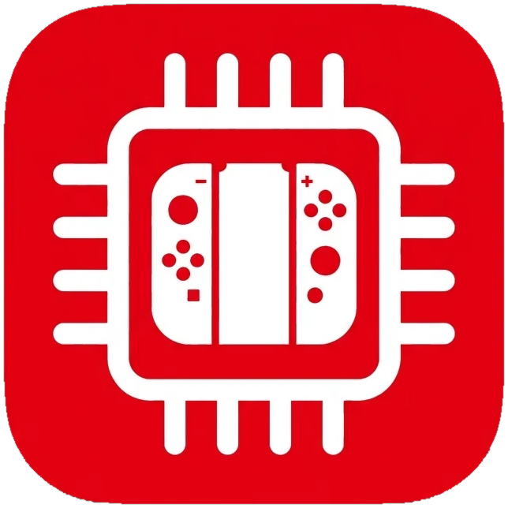
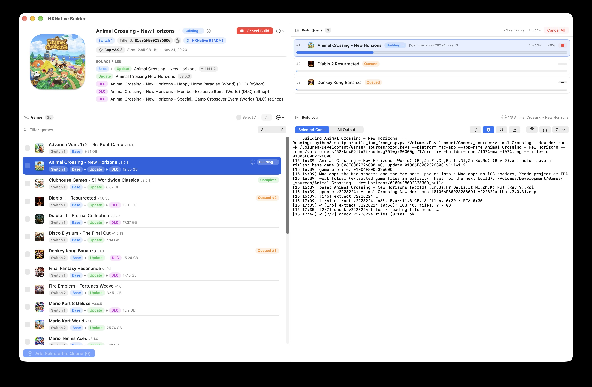
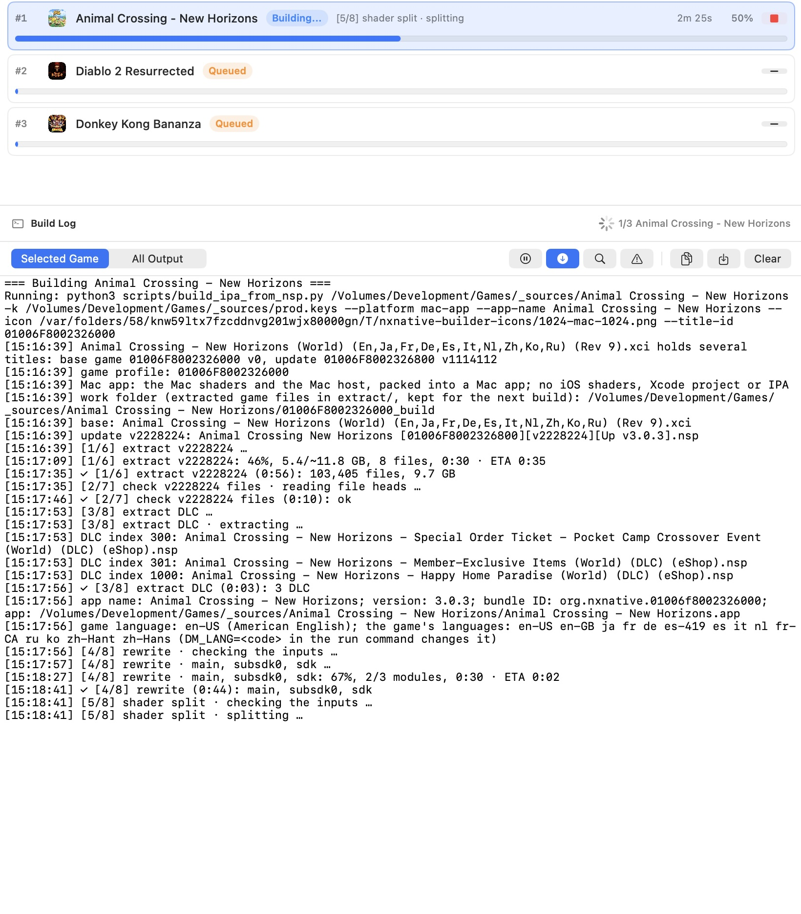
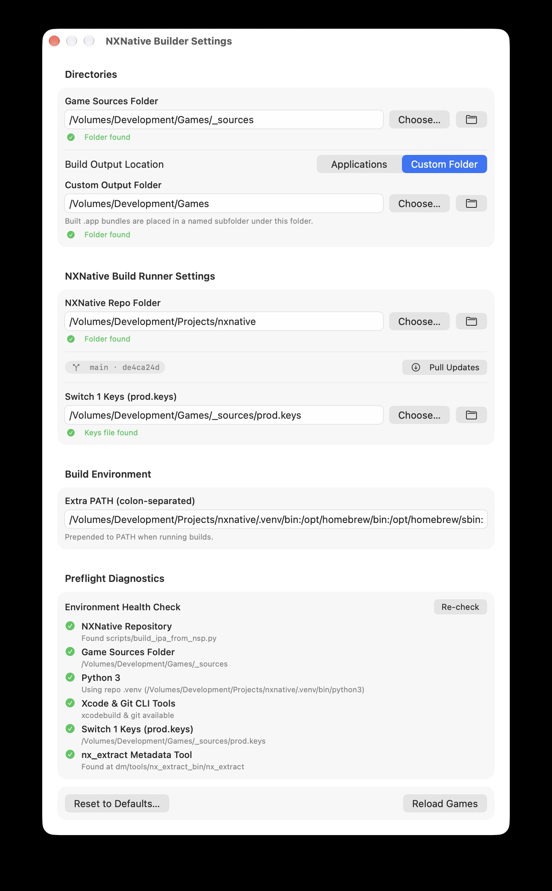
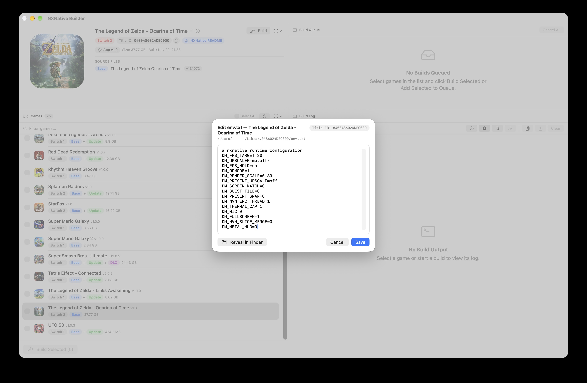

<div align="center">



# NXNative Builder

A native macOS app for managing, configuring, and building [nxnative](https://github.com/seedds/nxnative) games into macOS `.app`.

[](https://www.apple.com/macos/)
[](https://swift.org)
[](LICENSE)
[](https://github.com/LowRezBandit/nxnative-builder/actions/workflows/ci.yml)

</div>

---

## Screenshots

|             Main Window & Game Card              |                    Build Queue & Live Logs                    |
| :----------------------------------------------: | :-----------------------------------------------------------: |
|  |  |

|     Settings & Environment Diagnostics     |                    `env.txt` Editor                    |
| :----------------------------------------: | :----------------------------------------------------: |
|  |  |

---

## Features

### Library Scanning & Package Detection

- **Automatic Source Scanning:** Scans your Game Sources folder for `.nsp`, `.xci`, `.nsz`, and `.nup` packages, detects **Base**, **Update**, and **DLC** contents, and displays version tags.
- **Update Tracking:** Compares detected game updates against your built games and highlights when a newer update is available.
- **Multi-Game Package Support:** Folders containing multiple Title IDs automatically expand into separate game entries, grouping Base, Update, and DLC files.

### Per-Game Configuration & Metadata

- **Platform Auto-detection:** Chooses the correct build pipeline based off Title ID, automatically appending prod.keys to the build for Switch 1 titles.
- **Title ID & Output Name Overrides:** View, copy, or override the `Title ID`, and customize the output `.app` name per entry.
- **Built-In `env.txt` Editor:** Create, edit, and reveal per-title `nxnative` runtime overrides (`~/Library/Application Support/nxnative/<TITLE_ID>/env.txt`) directly in the app.
- **Game Notes (`readme.md`) Viewer:** Inspect per-title nxnative `readme.md` notes when available.
- **Automatic Icon Normalization:** Discovers folder or per-title icons (`.png`, `.jpg`, `.jpeg`, `.webp`, `.heic`, `.icns`) and processes them into `1024×1024` macOS rounded-corner PNGs before building.

### Build Queue, Logs & Cleanup

- **Sequential Batch Queue:** Build a single game or check multiple games to queue them sequentially, with support for cancelling queued items, retrying failed builds, and resuming interrupted queues.
- **Live Searchable Logs:** Toggle between per-game and combined session logs, filter output, jump to the next error, or copy/save logs to disk.
- **Preflight Diagnostics:** Validates your `nxnative` checkout, Python environment, Game Sources folder, and `prod.keys` before building.
- **Artifact & Disk Management:** Launch built `.app` bundles, reveal them in Finder, move built apps to Trash, or clean temporary `*_build` / `*_survey` folders.

---

## Prerequisites

- **macOS 14.0+** (Sonoma or newer)
- **Xcode / Swift 6 toolchain** (for building from source)
- **Python 3** & a local **[nxnative](https://github.com/seedds/nxnative)** checkout (`scripts/build_ipa_from_nsp.py`)
- **`prod.keys`** (user-provided, required for Switch 1 builds and `nx_extract --contents` scanning)

---

## Quick Start

```bash
# 1. Clone the repository
git clone https://github.com/lowrezbandit/nxnative-builder.git
cd nxnative-builder

# 2. Build the macOS .app bundle (outputs to dist/nxnative Builder.app)
./build.sh
```

Or build and run tests with Swift Package Manager:

```bash
swift build
swift test
```

On first launch, open **Settings** (`⌘,`) to configure your **Game Sources Folder**, **Build Output Location** (`/Applications` or a custom folder), **nxnative Repo Folder**, and **`prod.keys`** path. See [Docs/HOWTO.md](Docs/HOWTO.md) for the complete user guide.

---

## Project Structure

```text
nxnative-builder/
├── Package.swift          # SwiftPM manifest (macOS 14+, Swift 6 tools / Swift 5 mode)
├── build.sh               # Release .app bundle builder (outputs to dist/)
├── Sources/
│   ├── App/               # App entry point
│   ├── Models/            # GameEntry, BuildQueue, and package metadata models
│   ├── Services/          # BuildManager, GameScanner, PackageHeaderReader, PreflightChecker
│   └── Views/             # SwiftUI macOS views, sheets, and shared components
├── Tests/                 # Swift Testing unit test suite
├── Resources/             # Info.plist and AppIcon assets
└── Docs/                  # User documentation (HOWTO.md) and screenshots
```

---

## Documentation & Contributing

- **User & Setup Guide:** [Docs/HOWTO.md](Docs/HOWTO.md)
- **Contributing & Code Guidelines:** [CONTRIBUTING.md](CONTRIBUTING.md)

---

## License

This project is licensed under the **GNU General Public License v3.0** — see [LICENSE](LICENSE) for details.

---

## Disclaimer

nxnative Builder is a frontend utility for [nxnative](https://github.com/DinosaurMac/nxnative). It does **not** include any copyrighted game files, firmware, or encryption keys (`prod.keys`). You are responsible for supplying your own legally obtained backups and keys.
